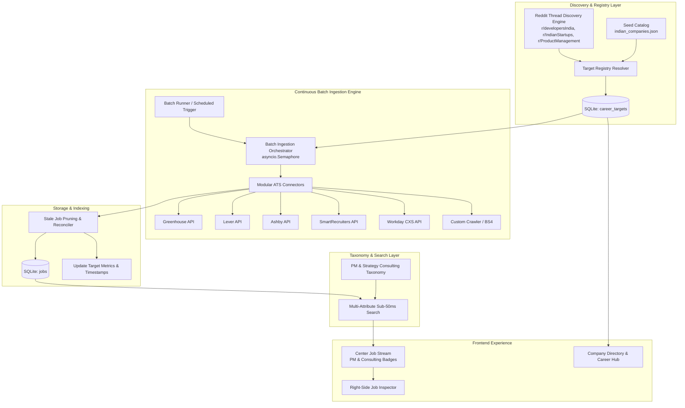

# Architecture & Subsystem Design: Milestone v5.0

## System Architecture



## Database Schema Extensions

### `career_targets` Table
```sql
CREATE TABLE IF NOT EXISTS career_targets (
    id TEXT PRIMARY KEY,
    name TEXT NOT NULL,
    slug TEXT NOT NULL UNIQUE,
    website TEXT,
    career_url TEXT NOT NULL,
    ats_type TEXT NOT NULL,          -- greenhouse, lever, ashby, smartrecruiters, workday, custom
    feed_url TEXT,
    category_tier TEXT NOT NULL,     -- startup, unicorn, enterprise, consulting
    domain TEXT NOT NULL,            -- Fintech, Quick Commerce, Enterprise SaaS, Consulting, etc.
    role_focus TEXT,                 -- json array: ["product", "strategy", "tech"]
    status TEXT DEFAULT 'active',    -- active, syncing, error, paused
    last_scraped_at TEXT,
    last_status TEXT,                -- ok, 404, rate_limited, failed
    job_count INTEGER DEFAULT 0,
    created_at TEXT NOT NULL
);

CREATE INDEX IF NOT EXISTS idx_targets_category ON career_targets(category_tier);
CREATE INDEX IF NOT EXISTS idx_targets_status ON career_targets(status);
CREATE INDEX IF NOT EXISTS idx_targets_last_scraped ON career_targets(last_scraped_at);
```

### Stale Listing Reconciliation Logic
When `sync_batch.py` runs for target company `C`:
1. Fetches current live listings $L_{current}$ from ATS feed.
2. Upserts all $L_{current}$ into `jobs` with `last_seen_at = now()`.
3. Detects previously stored jobs for company `C` with `last_seen_at < sync_start`.
4. Marks them inactive or removes them to prevent dead listings.
5. Updates `career_targets.job_count = len(L_{current})` and `last_scraped_at = now()`.
