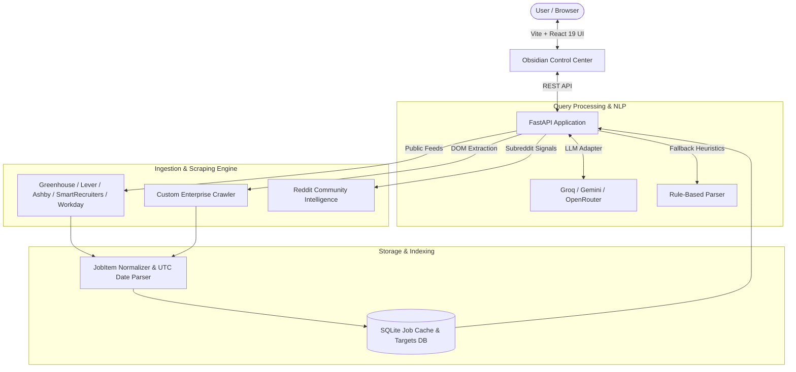

# CareerLoom 🌐⚡

> **Intelligent, Direct-from-Source Job Discovery Engine**  
> Direct ATS feeds, natural language role extraction, enterprise scraper pipelines, and community hiring intelligence.

[](https://fastapi.tiangolo.com)
[](https://react.dev)
[](https://www.typescriptlang.org)
[](https://vitejs.dev)
[](https://www.python.org)
[](https://opensource.org/licenses/MIT)

---

## 🎯 Overview

Most commercial job boards suffer from stale listings, spammy aggregators, rigid keyword filters, and paywalled application flows. **CareerLoom** bypasses middlemen by connecting directly to official Applicant Tracking System (ATS) endpoints and career portals of over **230+ global enterprises and top Indian unicorns**.

Powered by zero-cost online AI models (Groq Llama 3.3, Google Gemini Flash, OpenRouter) and sub-millisecond SQLite indexing, CareerLoom translates freeform natural language queries into exact role, seniority, and location filters—delivering verified direct-apply links with precise publication timestamps.

---

## ✨ Key Highlights

- **⚡ Direct ATS Ingestion**: Real-time integration with Greenhouse, Lever, Ashby, SmartRecruiters, and Workday public JSON feeds—eliminating scraper breakage and anti-bot obstacles.
- **🧠 Natural Language Role Search**: Search using conversational phrasing like *"product entry level"*, *"junior machine learning remote"*, or *"sde 2 in bangalore"*. Multi-model LLM parser translates queries into structured parameters with instant regex/heuristic fallbacks.
- **🧭 Canonical Taxonomy & 36+ Tracks**: 8 domain clusters covering Product Management (APM, TPM, GPM), Strategy Consulting (MBB, CorpDev, Chief of Staff), Software Engineering, AI/ML, Quant Finance, and Design.
- **🇮🇳 India Tech Unicorns & Leads Engine**: Deep coverage of 51+ Indian unicorns and conglomerates (Tata, Reliance, Swiggy, Zerodha, Razorpay) with Indian metro hub filters (Bengaluru, Delhi NCR, Mumbai, Hyderabad, Pune, Chennai) and CTC insights.
- **💬 Community Intelligence**: Integrated Reddit community intelligence (`r/developersIndia`, `r/cscareerquestions`) providing interview process timelines, hiring roadmaps, and insider reviews.
- **🌓 Dual-Theme Obsidian Control Center**: High-craft 3-column control center supporting Dark (*Obsidian Void*) and Light (*Obsidian Porcelain / Cool Slate*) modes calibrated to **WCAG 2.2 AA** contrast standards with fluid spring physics.
- **🗄️ Sub-50ms Persistent Caching**: High-concurrency async SQLite engine (`aiosqlite`) ensuring instant local searches and background synchronization.

---

## 🏛️ System Architecture



---

## 📂 Repository Structure

```
CareerLoom/
├── backend/                        # FastAPI Backend Application
│   ├── app/
│   │   ├── api/                    # REST endpoints (jobs, nlp, categories, targets, reddit)
│   │   ├── db/                     # SQLite connection pools & schema migrations
│   │   ├── models/                 # Pydantic data schemas (JobItem, Filters)
│   │   ├── scrapers/               # ATS parsers (Greenhouse, Lever, Ashby, Workday, etc.)
│   │   ├── services/               # Taxonomy engine, sync services, LLM adapters
│   │   └── utils/                  # Date parsing, role classifiers, metro mapping
│   ├── data/                       # Seed databases and registry snapshots
│   ├── scripts/                    # Discovery runners, partition builders, seed scripts
│   └── requirements.txt            # Python backend dependencies
├── frontend/                       # React 19 + TypeScript + Vite Frontend
│   ├── src/
│   │   ├── components/             # Control center, cards, modals, theme toggler
│   │   ├── hooks/                  # Custom React hooks (useTheme, etc.)
│   │   ├── styles/                 # Semantic design tokens & WCAG theme ramps
│   │   └── App.tsx                 # Core application shell
│   ├── package.json
│   └── vite.config.ts
├── tests/                          # 90+ comprehensive unit and integration tests
├── .planning/                      # Milestone roadmaps, architecture, and phase records
├── neural_map.md                   # System state machines and architectural flows
└── README.md
```

---

## 🚀 Quickstart

### Prerequisites

- **Python 3.11+**
- **Node.js 18+** & **npm**

### 1. Clone the Repository

```bash
git clone https://github.com/Prashant1873/CareerLoom.git
cd CareerLoom
```

### 2. Backend Setup

```bash
# Navigate to backend and install dependencies
pip install -r backend/requirements.txt

# (Optional) Set up free-tier LLM API keys in .env
# GROQ_API_KEY=your_groq_key
# GEMINI_API_KEY=your_gemini_key

# Run the FastAPI server
uvicorn backend.app.main:app --reload --port 8000
```

The interactive API documentation is available at `http://localhost:8000/docs`.

### 3. Frontend Setup

```bash
# In a new terminal, navigate to frontend
cd frontend

# Install packages
npm install

# Start the Vite development server
npm run dev
```

Open `http://localhost:5173` to experience CareerLoom.

---

## 🧪 Testing

The codebase includes an extensive Pytest suite validating ATS scrapers, NLP query parsing, taxonomy engines, and database indexing:

```bash
# Run the test suite
pytest tests/
```

---

## 🛠️ CLI Operations & Ingestion

Run ad-hoc discovery and data synchronization:

```bash
# Seed initial enterprise and startup targets
python -m backend.scripts.seed_targets

# Run live discovery sync across active ATS targets
python -m backend.scripts.run_discovery

# Reclassify jobs against latest taxonomy mappings
python -m backend.scripts.reclassify_jobs
```

---

## 🎨 Design Philosophy & Accessibility

CareerLoom adheres to strict modern UI craft standards:
- **WCAG 2.2 AA Compliant**: Hand-calibrated contrast ratios (> 4.5:1 text, > 3:1 controls) across both light and dark themes.
- **Zero Heavy Runtime CSS**: Clean Vanilla CSS custom properties with optical balance, fluid typography, and subtle micro-animations.
- **Keyboard & Screen-Reader Accessible**: Accessible modal traps, ARIA labels, and responsive drawer navigation.

---

## 📄 License

This project is licensed under the [MIT License](LICENSE).
