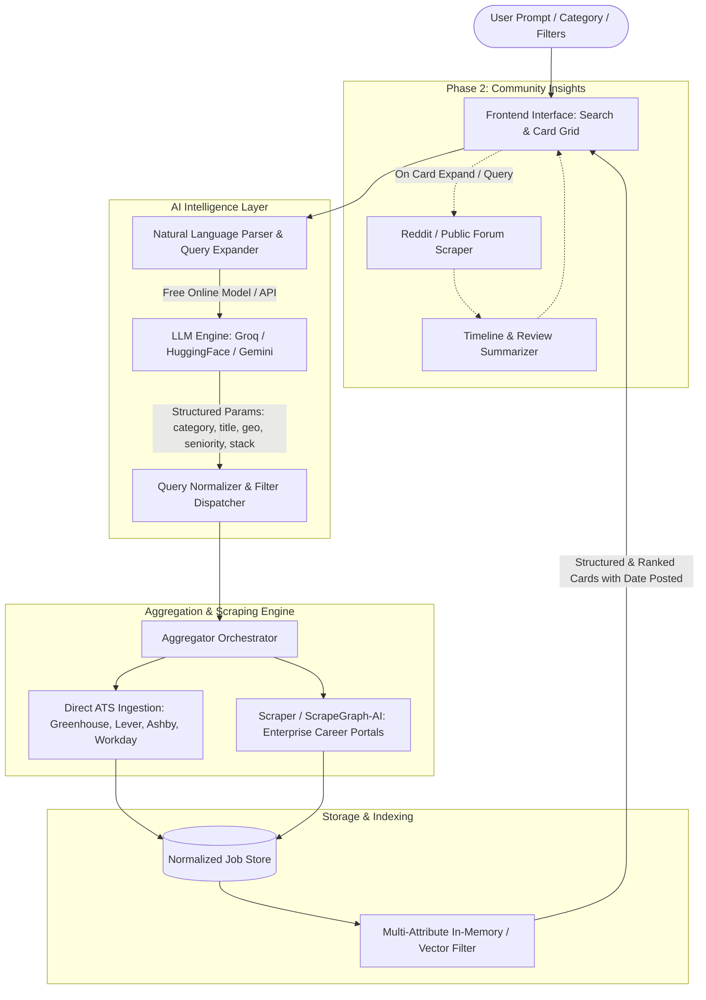

# Neural Map: Project Architecture & Logic

## Core Modules & Logic Flow

1. **User Interface (`UI`)**
   - Natural language input bar + categorical pills ("Product Entry Level", "ML New Grad").
   - Filter bar: Country / Remote, Domain / Industry, Freshness / Date Posted, Seniority.
   - Job Cards: Clean typography, direct apply CTA, posting date badge, company logo/tag, match score explanation.

2. **NL Query Interpreter (`NLP`)**
   - Ingests freeform input (e.g., "Find junior PM roles in London or fully remote posted this week").
   - Transforms into JSON query filters:
     - `categories`: `["product_management"]`
     - `seniority`: `["entry", "associate", "junior"]`
     - `locations`: `["London", "Remote"]`
     - `posted_within_days`: `7`

3. **Aggregator & Scraper Network (`Aggregator`)**
   - **Tier 1 (Fast & Reliable Direct APIs)**: Direct career APIs for Greenhouse (`boards-api.greenhouse.io`), Lever (`api.lever.co/v0/postings`), Ashby (`jobs.ashbyhq.com/api`), and Workday public endpoints.
   - **Tier 2 (AI/DOM Scrapers)**: ScrapeGraphAI or headless extractor for non-ATS custom career pages of major enterprises.

4. **Normalized Job Model**
   - `id`: Unique hash
   - `title`: String
   - `company`: String
   - `domain`: String (Tech, Finance, Healthcare, etc.)
   - `category`: Canonical category
   - `location`: Structured (Country, City, IsRemote)
   - `date_posted`: ISO timestamp
   - `apply_url`: Direct career site link
   - `description_summary`: Concise summary of requirements
   - `tags`: Skills / tech stack

5. **Community Insights (Phase 2)**
   - Reddit API / public search for `[company] + [role] + interview timeline / review`.
   - Distill consensus on response times, rounds, and work culture.
